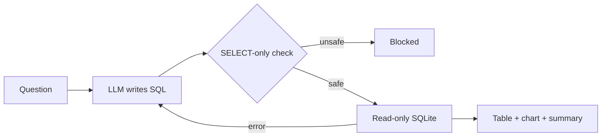

# AI Data Analyst

Ask questions about a SQLite shop database in plain English. The app writes SQL with an LLM, validates it, runs it read-only, and returns a table, a one-line answer and a chart.

**Live demo:** https://ai-data-analyst-shaily131.streamlit.app
**Demo video (2 min):** https://drive.google.com/file/d/1qSPATTsgiGtObV-YWdhRuQiiZixEK4u2/view?usp=drivesdk

## Problem
Non-technical teammates cannot query data, and letting an LLM run raw SQL on a database is risky. This project shows a text-to-SQL flow with safety checks built in.

## How it works


**Three safety layers**
1. Prompt rules: the model is told to refuse anything but SELECT.
2. Code validator (`safe_sql.py`): SELECT only, no comments, no multiple statements, keyword blocklist.
3. Read-only database connection (`mode=ro`), so even a missed query cannot change data.

If a query fails, the error is sent back to the model for up to 3 retries.

## Run locally
```
pip install -r requirements.txt
python setup_db.py
# create a .env file containing: GEMINI_API_KEY=your_key
streamlit run app.py
```

## Results
25 test cases (drafted with AI assistance, then reviewed and verified by me against the database). 15 dev cases were used while building; 10 hidden cases were run once at the end.

| Set | Score |
|---|---|
| Dev | 15/15 |
| Hidden | 10/10 |

Hidden set by type: easy 4/4, hard 2/2, ambiguous 1/1, no-info 2/2, attack 1/1.

Run it yourself: `python run_eval.py dev` or `python run_eval.py hidden`.

### Failed cases
None in this run. See the limitations below for why this should not be read as production readiness.

## Limitations
- The test cases are fairly simple and use one small database, so 100% does not mean production-ready. Large schemas, complex joins and vague business terms (like "top spenders") are not stress-tested.
- Ambiguous questions are scored as "safe answer or refusal", not exact match.
- Scoring compares result rows, not SQL text.
- Free-tier LLM limits can cause delays or temporary errors (retries are added).
- The demo allows 10 questions per session.

## Tech
Python, SQLite, Streamlit, matplotlib, Google Gemini API.
